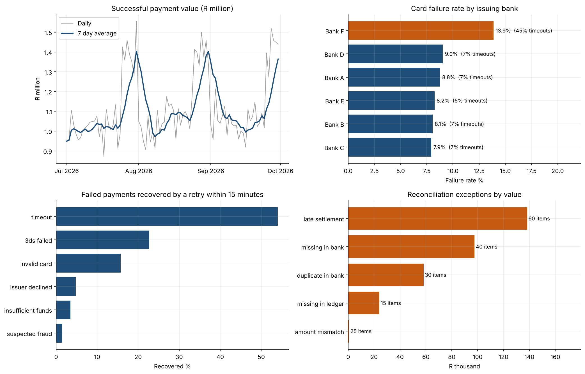

# Power BI Dashboard

The dashboard is built in Power BI Desktop (Windows) from the CSV files in `outputs/`. Run `py -m src.run_queries` first to create them.

## Data Model

A star schema with the payments ledger at the centre:

```
                 merchants
                     |
                     | merchant_id (1 to many)
                     |
   Date ---------- Payments ---------- Chargebacks
   (day)  created_at date        payment_id (1 to many)
```

| Table | Source file | Role |
| --- | --- | --- |
| Payments | `outputs/table_payments.csv` | Fact table, one row per payment attempt |
| Merchants | `outputs/table_merchants.csv` | Dimension |
| Chargebacks | `outputs/table_chargebacks.csv` | Fact table linked to payments |
| Date | Built in Power BI with `CALENDAR` | Dimension for time intelligence |
| Recon exceptions | `outputs/02_recon_exceptions.csv` | Operations page |

Steps:
1. **Get Data, Text/CSV** for each file above, and rename the tables to Payments, Merchants, Chargebacks and Recon Exceptions.
2. In Power Query, set `created_at` and `raised_at` to Date/Time and add a `payment_date` column (Date only) to Payments.
3. Create the Date table: **Modeling, New table**, then `Date = CALENDAR(DATE(2026,7,1), DATE(2026,12,31))`.
4. Relationships: Merchants[merchant_id] to Payments[merchant_id], Payments[payment_id] to Chargebacks[payment_id], Date[Date] to Payments[payment_date].

## Measures

Paste these into **Modeling, New measure**. The full list is in `measures.dax`.

```dax
Attempts = COUNTROWS(Payments)

Successful Payments = CALCULATE([Attempts], Payments[status] = "succeeded")

Success Rate = DIVIDE([Successful Payments], [Attempts])

Payment Value = CALCULATE(SUM(Payments[amount]), Payments[status] = "succeeded")

Average Ticket = DIVIDE([Payment Value], [Successful Payments])

Chargeback Rate =
DIVIDE(
    COUNTROWS(Chargebacks),
    CALCULATE([Successful Payments], Payments[channel] = "card")
)

Value 7 Day Average =
AVERAGEX(
    DATESINPERIOD('Date'[Date], MAX('Date'[Date]), -7, DAY),
    [Payment Value]
)
```

## Pages

| Page | Visuals |
| --- | --- |
| **Overview** | Cards: payment value, success rate, average ticket, chargeback rate. Line: daily value with 7 day average. Slicers: channel, category, province. |
| **Failed Payments** | Bar: failure rate by issuing bank, coloured by timeout share. Matrix: failure reason by channel. Line: failure rate by hour. |
| **Chargebacks** | Table: merchants ranked by chargeback rate with conditional formatting above 1%. Bar: value lost by reason. |
| **Reconciliation** | Cards: open exceptions and value at stake. Table: exception list with next action, filterable by type. |

## Preview

The chart below is generated in Python (`py -m src.charts`) from the same query outputs, as a preview of the Overview and Operations pages.


